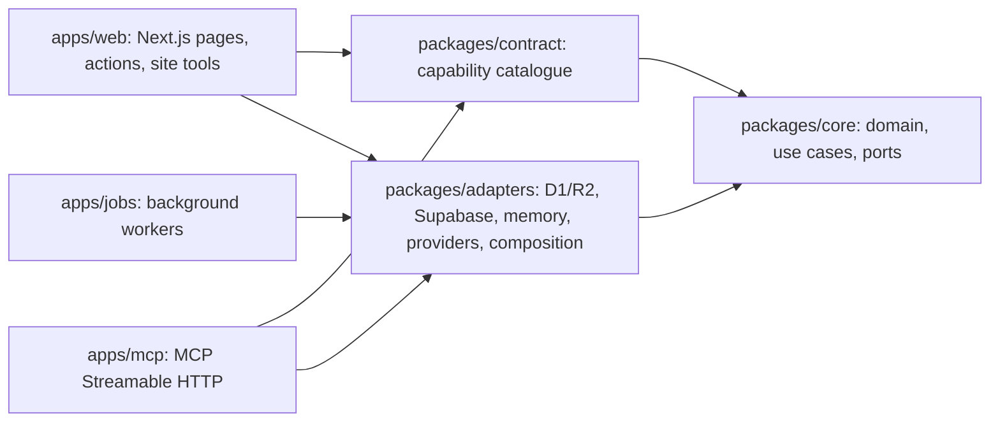

# Architecture

AtlasNews uses a small hexagonal architecture: business rules point inward, delivery and storage concerns stay at the edges, and composition happens in one infrastructure boundary.

## Dependency rule

An arrow means "may import". The domain must not import Next.js, React, Supabase, browser APIs or transport types. Adapters implement core ports, and the composition roots in `packages/adapters` choose an adapter from validated environment state. The contract describes what the system offers (tool names, schemas, hints, scopes, handlers) against ports that the delivery app fills in; it never imports adapters.

ESLint enforces this with `no-restricted-imports`, per layer:

| Layer | Package | May import | Must not import |
| --- | --- | --- | --- |
| Core | `@atlasnews/core` | itself, `zod` and the Markdown parsing libraries | `next`, `react`, `server-only`, `@supabase/*`, adapters, contract, any app |
| Contract | `@atlasnews/contract` | core, `zod` | `next`, `react`, `server-only`, `@supabase/*`, adapters, any app |
| Adapters | `@atlasnews/adapters` | core, provider and Supabase SDKs, the D1/R2 subset in `sites/cloudflare.ts` | `next`, `react`, `server-only`, any app |
| Apps | `@atlasnews/web`, `@atlasnews/mcp`, `@atlasnews/jobs` | core, contract, adapters | another app; `apps/mcp` and `apps/jobs` also not `next`, `react` or `server-only` |

Packages are consumed as TypeScript source through `exports`; there is no build step. `apps/web` lists them in `transpilePackages`, `apps/mcp` and `apps/jobs` run under `tsx`, and Vitest resolves them through the workspace. The `server-only` guard lives in `apps/web` files only, because it throws outside a React server environment. `@atlasnews/contract/page` is the browser-safe view of the catalogue (plain data, no handler or Node API), and a test enforces that.

## Layers

| Layer | Location | Responsibility |
| --- | --- | --- |
| Domain | `packages/core/src/<module>/domain`, `packages/core/src/locale.ts` | Article/category types, publication states, slug and reading-time rules, repository ports, locale contract |
| Application | `packages/core/src/<module>/application` | Pure command/query orchestration, story labels and Markdown, delivery-neutral cache invalidation port |
| Capability catalogue | `packages/contract/src` | Every tool once: name, title, description, zod input and output, annotation hints, required scopes, surfaces (`mcp`, `page`), confirmation question, handler |
| Inbound adapters | `apps/web/src/app`, `apps/web/src/server`, `apps/mcp/src`, `apps/jobs/src` | HTML, Server Actions, JSON-RPC, OAuth challenges, worker endpoints, localization, HTTP policy. `apps/mcp/src/adapter.ts` registers every catalogue capability, and only the MCP Apps tools in `apps/mcp/src/apps` (`open_newsroom`, `open_news_panel`, `build_briefing`, `search_mentions`) call `registerTool` themselves, because they need server features a capability does not carry (UI `_meta`, app-only visibility, input-required forms, the mentions extension); `apps/web/src/components/site/site-tools` registers the page capabilities as WebMCP tools |
| Outbound adapters | `packages/adapters/src` | In-memory demo, D1/R2 (Sites) and Supabase persistence, Resend/LinkedIn/X/WhatsApp providers, environment reading |
| Composition | `packages/adapters/src/*/container.ts`, `runtime.ts`, `apps/mcp/src/runtime-ports.ts` | Selects demo, Sites or Supabase without leaking adapter details and builds the ports a capability handler may use |
| Delivery composition | `apps/web/src/server/composition.ts`, `apps/web/src/lib/editorial-queries.ts`, `apps/web/src/lib/editorial-cache.ts` | Gives web code the composition roots and connects Next.js cache and cookie primitives to application/domain ports |
| Database | `apps/web/drizzle` (D1), `supabase/migrations` (Postgres) | Constraints, indexes, triggers, full-text search; on Postgres also RLS, grants and the `pg_cron` worker schedule |

Where each part runs depends on the deployment. On ChatGPT Sites (the default, [SITES.md](SITES.md)) one Worker, `apps/web/build/sites-worker.ts`, composes all three apps: the Next.js app, `apps/mcp` at `/mcp` and `apps/jobs` at `/internal/*` and in the background of requests; data is D1 and R2, and Sign in with ChatGPT identifies editors for the Studio and the MCP server alike (Google and GitHub sign-in are own OAuth adapters in `packages/adapters/src/auth`, and editors are matched by verified email, so one person can use any of them). Self-hosted ([DEPLOYMENT.md](DEPLOYMENT.md), [HOSTING.md](HOSTING.md)), `apps/mcp` and `apps/jobs` run as containers, `pg_cron` in Supabase calls the workers, and Supabase Auth signs editors in to the Studio and acts as the MCP server's OAuth 2.1 authorization server ([MCP.md](MCP.md#sign-in-with-supabase-auth)). `apps/web/build` is the one place an app imports the other apps, and only their request handlers.

## Main flows

### Public read

1. A locale-prefixed Next.js route validates `en` or `it`.
2. A thin Next.js composition adapter asks the `ArticleRepository` port for published content.
3. The composition root selects the demo, D1 or Supabase adapter for the content mode.
4. Public pages return Server Component HTML; delivery-side cached feed/article queries use explicit revalidation windows.
5. Archive pages render their first slice in HTML, then the web delivery adapter requests compact list items with the same opaque composite cursor used by MCP.

### Editorial write

1. The authenticated studio submits a Server Action.
2. Input is parsed at the delivery boundary and passed to the shared `ArticleCommandService` invariants.
3. The action rechecks the Auth user and editor profile; page/proxy checks are not trusted as authorization.
4. The repository writes through Supabase and RLS evaluates the mutation again.
5. The `articles` data tag plus localized pages, archives, API, RSS and sitemap are invalidated immediately. Writes made through `apps/mcp` run in another process, so the site picks them up when its cached feed (60 seconds) and article (300 seconds) windows expire.

### MCP read

1. `apps/mcp` serves `POST /mcp` with Streamable HTTP JSON-RPC, anonymous or with a Bearer token.
2. `apps/mcp/src/adapter.ts` registers every catalogue capability whose surfaces include `mcp`; zod validates arguments at the transport boundary.
3. Read tools depend on the same read-only editorial port as the site and serialize only published records into explicit output schemas.

### MCP newsroom write

1. A scoped tool called without a token is answered with HTTP 401 and a Bearer challenge that points at the OAuth resource metadata; the host runs OAuth 2.1 sign-in against Supabase Auth.
2. A valid access token (or the optional CI API key) becomes a principal with scopes derived from the editor's profile role; a signed-in person without an editor profile gets no newsroom scope.
3. The handler uses the server-only Supabase client with the service-role key; the editor's own author ID is carried on the principal and attributed to the write. Neither reaches the browser.
4. Tools that publish, delete, email or post ask for confirmation through a form, or need `confirm: true`. Email and social delivery are queued; the leased outbox workers send them.
5. After an editorial write `apps/mcp` asks the site to invalidate its caches through `POST /api/revalidate`.

### Content management

Articles, categories, entities and media are written by the same use cases whichever surface asks. The WebMCP editor tools and the MCP endpoint run the catalogue capabilities in `packages/contract`; the web side reaches them through `apps/web/src/server/capabilities.ts` (`runEditorCapability`, which the page route `POST /api/capabilities/{name}` also calls), and the MCP side through `apps/mcp/src/adapter.ts`. Every Studio write runs a capability from a Server Action through `runStudioCapability` (`apps/web/src/server/studio-capability.ts`, built on `runEditorCapability`): articles (save, publish, unpublish, delete, with the link to the translation), categories, entities, media delete, team, bulk article actions, comment moderation, the inbox, the newsletter campaign form, subscription status and reconfirmation, and the social composer and queue. So the scope check, the attribution and the confirmation are the same on every surface, and a refusal reaches the Studio as a stable `code` that `studio.ruleErrors` writes in the editor's language (the English message stays for agents). An ESLint rule keeps it that way: a `*actions.ts` file under `apps/web/src/app` (the reader site's token-checked actions excepted) may not import `@atlasnews/core/*/application/*` or `@/server/composition`. The one write that is not a capability call is the Studio media upload (`apps/web/src/server/media-upload.ts`): `admin_upload_media` carries an image as base64 of up to 160 KiB, and the Studio takes files of up to 8 MiB, so the upload runs `MediaCommandService` directly behind the same scope check (`authorizeEditorCapability("admin_upload_media")`). The social post's rules (the publication must belong to the locale and channel, the article address is the canonical one) are `findPublication` and `canonicalArticleUrl` in `editorial-operations.ts`. Each rule therefore has one owner in `packages/core/src/editorial/application/`: `article-commands.ts`, `category-commands.ts`, `entity-commands.ts` and `media-commands.ts`. Each service depends only on its repository port (`ArticleRepository`, `CategoryAdminRepository`, `EntityAdminRepository`, `MediaRepository`); the article service also reads entities through the `findEntityBySlug` part of `EntityRepository`.

Batch writes follow one rule: validate every item first, then write the batch in one transaction. `validateEach` checks all items and reports every invalid one by index, so a rejected batch writes nothing. The Supabase adapter then applies a valid batch in a single RPC, for example `save_articles_batch`, `create_categories_batch` or `create_entities_batch`, so the batch either lands completely or not at all; the D1 adapter sends the whole batch as one `database.batch()`, which D1 applies atomically. Media is the exception: storage is not a database, so a batch upload that fails halfway removes the files it had already stored. The comment, inbox and social-outbox batches follow the same rule: Supabase loops the single-item function inside one RPC, and D1 guards one `UPDATE` with the count of eligible rows, so a target that became ineligible leaves every target untouched.

### Team management

Who may use the Studio and the newsroom tools is managed the same way. `packages/core/src/team` holds the rules (`TeamService`: valid address, role editor or admin, no address twice, never demote or remove the last active admin, an admin cannot remove themselves) over the `EditorDirectory` port, with an adapter per backend in `packages/adapters/src/team`: memory (demo), D1 over the `editors` table, and Supabase (`public.profiles` plus the Auth admin API `inviteUserByEmail`). The four `admin_*_editor` capabilities need the `newsroom.admin` scope, which `scopesForRole` grants to the `admin` role only; the Studio's Team page and the MCP tools both run them. These adapters have full access to their store, so the delivery layer is the boundary: the scope in the capability, and `getStudioEditorDirectory` in the web composition, which hands the directory only to a signed-in admin.

### Operations (comments, inbox, distribution, newsletter, social)

What an editor does in these Studio screens is also a catalogue capability with the `page` surface (`specs/{comments,support,newsroom,newsletter,social}.ts`), so an agent on MCP or in the Studio page (WebMCP) can do it. The page builds the ports as the Studio does (`createMutationCommentService`, `getStudioContactMessageService`, `getStudioNewsletterCampaignService`, `getNewsletterDeliveryService`, `createSocialPublishingRuntime`) and an unconfigured backend answers with the capability's `unavailableMessage` (503). Comment moderation records a user actor for a signed-in editor on every surface; the shared API key stays a system actor with its label. Not on the page, because no Studio screen does it: the outbox workers (`admin_comment_process_notifications`, `admin_newsletter_process_outbox`, `admin_social_process_outbox`), `admin_newsletter_erase_subscription`, and the public `list_comments`.

### Site tools

1. The reader site loads the page capabilities of the catalogue as plain data and registers them with `document.modelContext.registerTool` only where WebMCP exists.
2. Handlers run in the open page against the app router, the DOM and `localStorage` bookmarks, so the agent and the reader share one live page ([SITE_TOOLS.md](SITE_TOOLS.md)).

## Domain invariants

- `locale` is explicit on every category and article.
- `translation_key` links language variants; it is not a public slug.
- Slugs are unique per locale and remain locale-specific.
- A published article requires `published_at`; a scheduled article requires `scheduled_for`.
- Article/category foreign keys preserve locale consistency.
- Search vectors use English or Italian dictionaries according to the row locale.
- Social publication state records intent/status; outbound network posting is a separate authorized operation.
- Newsletter emails are normalized and unique. Anonymous writes pass through a security-definer RPC that validates input, returns a uniform result, and leaves the table without a direct anonymous insert policy.

## Adapter selection

`ATLASNEWS_CONTENT_MODE=sites|supabase|demo` is the composition switch (`packages/adapters/src/config/env.ts`). Unset, a D1 binding selects `sites`, Supabase configuration selects `supabase`, and anything else is `demo`. Sites mode requires the `DB` and `BUCKET` bindings; D1 has no row-level security, so the delivery layer is the authorization boundary there (the Studio receives repositories only for a signed-in editor). Supabase mode requires both `NEXT_PUBLIC_SUPABASE_URL` and `NEXT_PUBLIC_SUPABASE_ANON_KEY`; partial configuration throws instead of falling back. Demo remains deterministic for development and CI. Studio uses demo only outside production or with the emergency `ATLASNEWS_ENABLE_DEMO_STUDIO=true` opt-in; production demo does not acknowledge ephemeral newsletter writes. `/api/health` returns `503` until production uses persistent content and a canonical HTTPS origin.

## Article Markdown

Article bodies are GFM rendered by one component, `apps/web/src/components/markdown/markdown-renderer.tsx` (react-markdown; Server Component on article pages, also used by the Studio preview). Raw HTML is dropped, link schemes are filtered and images must pass `editorial-image.ts`. Three extensions sit on top, all plain Markdown that degrades to a quote, a code block or a link wherever the text is read raw (the `/md` route, feeds, MCP `get_article`, email):

- **Code highlighting.** A fence tagged `ts`, `js`, `json`, `bash`, `python`, `sql`, `yaml`, `html`, `css`, `diff`, `go` or `rust` (or an alias such as `sh`, `py`, `yml`) is highlighted while rendering, with lowlight and token colours in `globals.css`; other languages stay plain. Only those grammars are bundled (`highlight.ts`). The server pages ship no highlighting code; the Studio preview loads it, about 23 KB gzipped, with its lazy chunk.
- **Callouts.** A top-level quote whose first line is `[!NOTE]`, `[!TIP]`, `[!IMPORTANT]`, `[!WARNING]` or `[!CAUTION]` (GitHub alert syntax) renders as an `<aside role="note">` with a title from `messages.markdown.callouts` in the article locale. Nested quotes and other markers stay quotes.
- **Embeds.** A paragraph that is only a YouTube (`youtube.com/watch?v=`, `youtu.be/`, `/shorts/`) or X status URL (`x.com|twitter.com/<user>/status/<id>`) becomes a click-to-load facade. The page makes no third-party request until the click; then it loads `youtube-nocookie.com/embed/<id>` or `platform.twitter.com/embed/Tweet.html?id=<id>` in a sandboxed lazy iframe (`embed-frame.tsx`, the only client component). Ids are validated strictly (YouTube 11 characters of `[A-Za-z0-9_-]`, X digits); a labelled link, a URL inside prose, a list or a quote stays a link. No CSP restricts frames today; a future `frame-src` must allow those two hosts.

## Design principles

- **KISS:** two persistence adapters, use-case-sized ports, one composition root.
- **DRY:** site, MCP and site tools share one capability catalogue, one cursor encoding, one set of story labels and serialization-ready domain objects.
- **SOLID:** delivery depends on ports; adapters are substitutable; interfaces stay use-case sized.
- **Fail visibly:** malformed input and unavailable data become bounded errors; no silent cross-locale content fallback.
- **Least privilege:** the browser receives only the anon/publishable key; the service-role key is isolated to the signed-in newsroom tools of the MCP server and to the workers, while Studio continues to rely on RLS and SQL grants.

## Change checklist

When adding a capability:

1. Add a domain rule only if it is transport- and database-independent.
2. Extend the smallest relevant port.
3. Implement the memory, D1 and Supabase adapters together.
4. Add one application use case, then thin delivery adapters.
5. Put input and output validation at each external boundary.
6. Add a migration for persistent invariants and indexes.
7. Prove the changed path in demo, D1 (Miniflare) and Supabase modes when persistence behavior changes.
