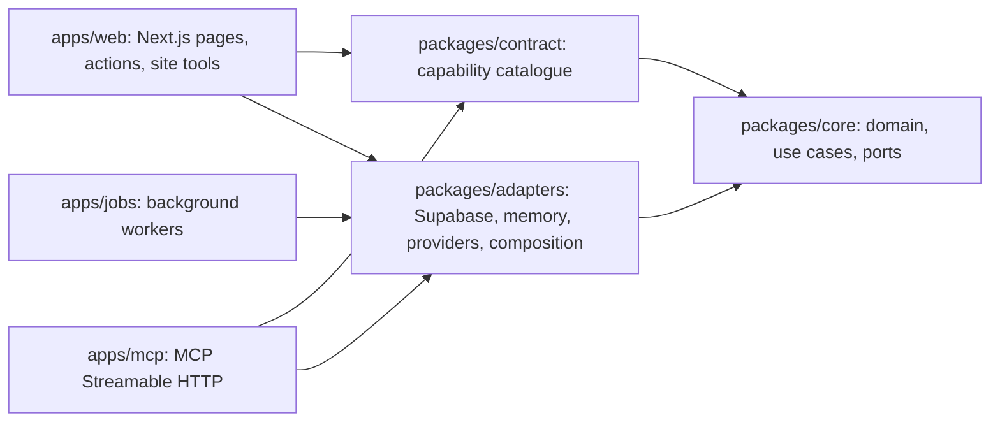

# Architecture

AtlasNews uses a small hexagonal architecture: business rules point inward, delivery and storage concerns stay at the edges, and composition happens in one infrastructure boundary.

## Dependency rule

An arrow means "may import". The domain must not import Next.js, React, Supabase, browser APIs or transport types. Adapters implement core ports, and the composition roots in `packages/adapters` choose an adapter from validated environment state. The contract describes what the system offers (tool names, schemas, hints, scopes, handlers) against ports that the delivery app fills in; it never imports adapters.

ESLint enforces this with `no-restricted-imports`, per layer:

| Layer | Package | May import | Must not import |
| --- | --- | --- | --- |
| Core | `@atlasnews/core` | itself, `zod` and the Markdown parsing libraries | `next`, `react`, `server-only`, `@supabase/*`, adapters, contract, any app |
| Contract | `@atlasnews/contract` | core, `zod` | `next`, `react`, `server-only`, `@supabase/*`, adapters, any app |
| Adapters | `@atlasnews/adapters` | core, provider and Supabase SDKs | `next`, `react`, `server-only`, any app |
| Apps | `@atlasnews/web`, `@atlasnews/mcp`, `@atlasnews/jobs` | core, contract, adapters | another app; `apps/mcp` and `apps/jobs` also not `next`, `react` or `server-only` |

Packages are consumed as TypeScript source through `exports`; there is no build step. `apps/web` lists them in `transpilePackages`, `apps/mcp` and `apps/jobs` run under `tsx`, and Vitest resolves them through the workspace. The `server-only` guard lives in `apps/web` files only, because it throws outside a React server environment. `@atlasnews/contract/page` is the browser-safe view of the catalogue (plain data, no handler or Node API), and a test enforces that.

## Layers

| Layer | Location | Responsibility |
| --- | --- | --- |
| Domain | `packages/core/src/<module>/domain`, `packages/core/src/locale.ts` | Article/category types, publication states, slug and reading-time rules, repository ports, locale contract |
| Application | `packages/core/src/<module>/application` | Pure command/query orchestration, story labels and Markdown, delivery-neutral cache invalidation port |
| Capability catalogue | `packages/contract/src` | Every tool once: name, title, description, zod input and output, annotation hints, required scopes, surfaces (`mcp`, `page`), confirmation question, handler |
| Inbound adapters | `apps/web/src/app`, `apps/web/src/server`, `apps/mcp/src`, `apps/jobs/src` | HTML, Server Actions, JSON-RPC, OAuth challenges, worker endpoints, localization, HTTP policy. `apps/mcp/src/adapter.ts` is the only generic `registerTool`; `apps/web/src/components/site/site-tools` registers the page capabilities as WebMCP tools |
| Outbound adapters | `packages/adapters/src` | In-memory demo and Supabase persistence, Resend/LinkedIn/X/WhatsApp providers, environment reading |
| Composition | `packages/adapters/src/*/container.ts`, `runtime.ts`, `apps/mcp/src/runtime-ports.ts` | Selects demo or Supabase without leaking adapter details and builds the ports a capability handler may use |
| Delivery composition | `apps/web/src/server/composition.ts`, `apps/web/src/lib/editorial-queries.ts`, `apps/web/src/lib/editorial-cache.ts` | Gives web code the composition roots and connects Next.js cache and cookie primitives to application/domain ports |
| Database | `supabase/migrations` | Constraints, indexes, RLS, grants, triggers, full-text vectors, the `pg_cron` worker schedule |

Where each part runs: `apps/web` on ChatGPT Sites ([SITES.md](SITES.md)); `apps/mcp` and `apps/jobs` as containers ([HOSTING.md](HOSTING.md)); the schedule that calls `apps/jobs` is `pg_cron` in Supabase ([DEPLOYMENT.md](DEPLOYMENT.md#schedule-the-workers)); Supabase Auth signs editors in to the Studio and, for the MCP server, acts as the OAuth 2.1 authorization server ([MCP.md](MCP.md#sign-in-with-supabase-auth)).

## Main flows

### Public read

1. A locale-prefixed Next.js route validates `en` or `it`.
2. A thin Next.js composition adapter asks the `ArticleRepository` port for published content.
3. The composition root selects the explicit demo or Supabase adapter.
4. Public pages return Server Component HTML; delivery-side cached feed/article queries use explicit revalidation windows.
5. Archive pages render their first slice in HTML, then the web delivery adapter requests compact list items with the same opaque composite cursor used by MCP.

### Editorial write

1. The authenticated studio submits a Server Action.
2. Input is parsed at the delivery boundary and passed to the shared `ArticleCommandService` invariants.
3. The action rechecks the Auth user and editor profile; page/proxy checks are not trusted as authorization.
4. The repository writes through Supabase and RLS evaluates the mutation again.
5. The `articles` data tag plus localized pages, archives, API, RSS and sitemap are invalidated immediately. Writes made through `apps/mcp` run in another process, so the site picks them up when its cached feed (60 seconds) and article (300 seconds) windows expire.

### MCP read

1. `apps/mcp` serves `POST /mcp` with Streamable HTTP JSON-RPC, anonymous or with a Bearer token.
2. `apps/mcp/src/adapter.ts` registers every catalogue capability whose surfaces include `mcp`; zod validates arguments at the transport boundary.
3. Read tools depend on the same read-only editorial port as the site and serialize only published records into explicit output schemas.

### MCP newsroom write

1. A scoped tool called without a token is answered with HTTP 401 and a Bearer challenge that points at the OAuth resource metadata; the host runs OAuth 2.1 sign-in against Supabase Auth.
2. A valid access token (or the optional CI API key) becomes a principal with scopes derived from the editor's profile role; a signed-in person without an editor profile gets no newsroom scope.
3. The handler uses the server-only Supabase client with the service-role key; the editor's own author ID is carried on the principal and attributed to the write. Neither reaches the browser.
4. Tools that publish, delete, email or post ask for confirmation through a form, or need `confirm: true`. Email and social delivery are queued; the leased outbox workers send them.
5. After an editorial write `apps/mcp` asks the site to invalidate its caches through `POST /api/revalidate`.

### Site tools

1. The reader site loads the page capabilities of the catalogue as plain data and registers them with `document.modelContext.registerTool` only where WebMCP exists.
2. Handlers run in the open page against the app router, the DOM and `localStorage` bookmarks, so the agent and the reader share one live page ([SITE_TOOLS.md](SITE_TOOLS.md)).

## Domain invariants

- `locale` is explicit on every category and article.
- `translation_key` links language variants; it is not a public slug.
- Slugs are unique per locale and remain locale-specific.
- A published article requires `published_at`; a scheduled article requires `scheduled_for`.
- Article/category foreign keys preserve locale consistency.
- Search vectors use English or Italian dictionaries according to the row locale.
- Social publication state records intent/status; outbound network posting is a separate authorized operation.
- Newsletter emails are normalized and unique. Anonymous writes pass through a security-definer RPC that validates input, returns a uniform result, and leaves the table without a direct anonymous insert policy.

## Adapter selection

`ATLASNEWS_CONTENT_MODE=demo|supabase` is the explicit composition switch. Supabase mode requires both `NEXT_PUBLIC_SUPABASE_URL` and `NEXT_PUBLIC_SUPABASE_ANON_KEY`; partial configuration throws instead of falling back. Demo remains deterministic for development and CI. Studio uses demo only outside production or with the emergency `ATLASNEWS_ENABLE_DEMO_STUDIO=true` opt-in; production demo does not acknowledge ephemeral newsletter writes. `/api/health` returns `503` until production uses persistent content and a canonical HTTPS origin.

## Design principles

- **KISS:** two persistence adapters, use-case-sized ports, one composition root.
- **DRY:** site, MCP and site tools share one capability catalogue, one cursor encoding, one set of story labels and serialization-ready domain objects.
- **SOLID:** delivery depends on ports; adapters are substitutable; interfaces stay use-case sized.
- **Fail visibly:** malformed input and unavailable data become bounded errors; no silent cross-locale content fallback.
- **Least privilege:** the browser receives only the anon/publishable key; the service-role key is isolated to the signed-in newsroom tools of the MCP server and to the workers, while Studio continues to rely on RLS and SQL grants.

## Change checklist

When adding a capability:

1. Add a domain rule only if it is transport- and database-independent.
2. Extend the smallest relevant port.
3. Implement memory and Supabase adapters together.
4. Add one application use case, then thin delivery adapters.
5. Put input and output validation at each external boundary.
6. Add a migration for persistent invariants and indexes.
7. Prove the changed path in demo and Supabase modes when persistence behavior changes.
