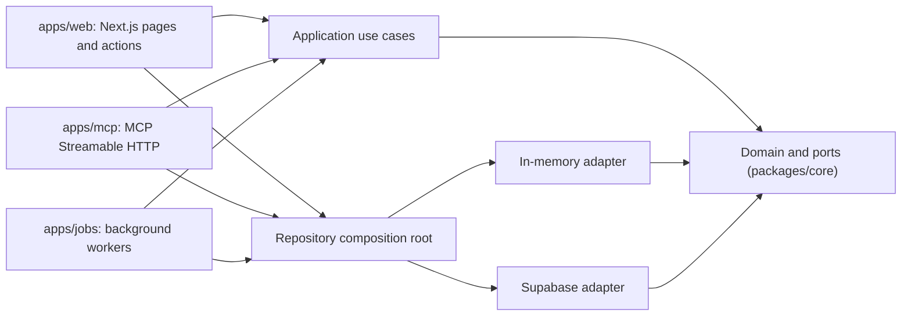

# Architecture

NEURA uses a small hexagonal architecture: business rules point inward, delivery and storage concerns stay at the edges, and composition happens in one infrastructure boundary.

## Dependency rule

The domain must not import Next.js, React, Supabase, browser APIs, or transport types. Adapters implement domain ports; the composition root selects an adapter from validated environment state.

The repository enforces this as an npm workspace dependency rule, checked by ESLint (`no-restricted-imports`):

- `packages/core` (`@atlasnews/core`) imports nothing from `next`, `react`, `server-only`, `@supabase/*`, the adapters package, the contract package or any app.
- `packages/contract` (`@atlasnews/contract`) may import `core` and `zod` only; it is empty until a later step fills it.
- `packages/adapters` (`@atlasnews/adapters`) imports `core`, never an app or the framework.
- `apps/web`, `apps/mcp` and `apps/jobs` import packages; no app imports another app.

Packages are consumed as TypeScript source through `exports`; there is no build step. `apps/web` lists them in `transpilePackages`, `apps/mcp` and `apps/jobs` run under `tsx`, and Vitest resolves them through the workspace. The `server-only` guard lives in `apps/web` files only, because it throws outside a React server environment.

## Layers

| Layer | Location | Responsibility |
| --- | --- | --- |
| Domain | `packages/core/src/<module>/domain`, `packages/core/src/locale.ts` | Article/category types, publication states, slug and reading-time rules, repository ports, locale contract |
| Application | `packages/core/src/<module>/application` | Pure command/query orchestration and delivery-neutral cache invalidation port |
| Inbound adapters | `apps/web/src/app`, `apps/web/src/server`, `apps/mcp/src`, `apps/jobs/src` | HTML, Server Actions, JSON-RPC, worker endpoints, localization, HTTP policy |
| Outbound adapters | `packages/adapters/src` | In-memory demo and Supabase persistence, Resend/LinkedIn/X/WhatsApp providers, environment reading |
| Composition | `packages/adapters/src/*/container.ts`, `runtime.ts` | Selects demo or Supabase without leaking adapter details |
| Delivery composition | `apps/web/src/server/composition.ts`, `apps/web/src/lib/editorial-queries.ts`, `apps/web/src/lib/editorial-cache.ts` | Gives web code the composition roots and connects Next.js cache and cookie primitives to application/domain ports |
| Database | `supabase/migrations` | Constraints, indexes, RLS, grants, triggers, full-text vectors |

## Main flows

### Public read

1. A locale-prefixed Next.js route validates `en` or `it`.
2. A thin Next.js composition adapter asks the `ArticleRepository` port for published content.
3. The composition root selects the explicit demo or Supabase adapter.
4. Public pages return Server Component HTML; delivery-side cached feed/article queries use explicit revalidation windows.
5. Archive pages render their first slice in HTML, then the web delivery adapter requests compact list items with the same opaque composite cursor used by MCP.

### Editorial write

1. The authenticated studio submits a Server Action.
2. Input is parsed at the delivery boundary and passed to the shared `ArticleCommandService` invariants.
3. The action rechecks the Auth user and editor profile; page/proxy checks are not trusted as authorization.
4. The repository writes through Supabase and RLS evaluates the mutation again.
5. The `articles` data tag plus localized pages, archives, API, RSS and sitemap are invalidated immediately. Writes made through `apps/mcp` run in another process, so the site picks them up when its cached feed (60 seconds) and article (300 seconds) windows expire.

### MCP read

1. `apps/mcp` serves `POST /mcp` with Streamable HTTP JSON-RPC.
2. Zod schemas validate tool arguments at the transport boundary.
3. Tools depend on the same read-only editorial port as the site.
4. Only published records are serialized into explicit output schemas.

### MCP editorial write

1. `POST /mcp/admin` on `apps/mcp` verifies a high-entropy Bearer key before parsing or composing persistence.
2. Zod schemas validate article, distribution, consent-registry and media inputs.
3. The server-only Supabase client uses a service-role key and a configured editor author ID; neither reaches the browser.
4. Public MCP remains a different read-only adapter and cannot acquire mutation tools accidentally.
5. External social/email delivery is never inferred: MCP updates auditable workflow state only.

## Domain invariants

- `locale` is explicit on every category and article.
- `translation_key` links language variants; it is not a public slug.
- Slugs are unique per locale and remain locale-specific.
- A published article requires `published_at`; a scheduled article requires `scheduled_for`.
- Article/category foreign keys preserve locale consistency.
- Search vectors use English or Italian dictionaries according to the row locale.
- Social publication state records intent/status; outbound network posting is a separate authorized operation.
- Newsletter emails are normalized and unique. Anonymous writes pass through a security-definer RPC that validates input, returns a uniform result, and leaves the table without a direct anonymous insert policy.

## Adapter selection

`NEURA_CONTENT_MODE=demo|supabase` is the explicit composition switch. Supabase mode requires both `NEXT_PUBLIC_SUPABASE_URL` and `NEXT_PUBLIC_SUPABASE_ANON_KEY`; partial configuration throws instead of falling back. Demo remains deterministic for development and CI. Studio uses demo only outside production or with the emergency `NEURA_ENABLE_DEMO_STUDIO=true` opt-in; production demo does not acknowledge ephemeral newsletter writes. `/api/health` returns `503` until production uses persistent content and a canonical HTTPS origin.

## Design principles

- **KISS:** two persistence adapters, use-case-sized ports, one composition root.
- **DRY:** site and MCP share editorial queries, cursor encoding, and serialization-ready domain objects.
- **SOLID:** delivery depends on ports; adapters are substitutable; interfaces stay use-case sized.
- **Fail visibly:** malformed input and unavailable data become bounded errors; no silent cross-locale content fallback.
- **Least privilege:** the browser receives only the anon/publishable key; the service-role key is isolated to the authenticated admin MCP endpoint and the workers, while Studio continues to rely on RLS and SQL grants.

## Change checklist

When adding a capability:

1. Add a domain rule only if it is transport- and database-independent.
2. Extend the smallest relevant port.
3. Implement memory and Supabase adapters together.
4. Add one application use case, then thin delivery adapters.
5. Put input and output validation at each external boundary.
6. Add a migration for persistent invariants and indexes.
7. Prove the changed path in demo and Supabase modes when persistence behavior changes.
